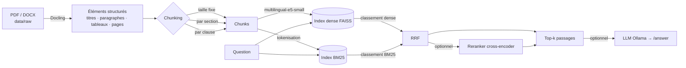

# RAG hybride avec extraction layout-aware (Docling)

Moteur de recherche documentaire sur PDF et DOCX en français : extraction qui
conserve la structure (titres, paragraphes, tableaux, pages), trois stratégies de
découpage, recherche dense + BM25 fusionnée par Reciprocal Rank Fusion, et un
protocole d'évaluation reproductible. 100 % local et gratuit (LLM optionnel via Ollama).

## Problème

Les documents administratifs et contractuels (CCAG, règlements de consultation, DC1/DC2…)
sont longs, structurés et pleins de références croisées. Un découpage naïf coupe les clauses
et noie les tableaux. La recherche purement dense rate les termes exacts (numéros d'articles,
sigles) ; BM25 seul rate les reformulations. Ce projet mesure, sur un jeu de questions
étiquetées à la main, l'apport de **(a)** la structure du document dans le découpage et
**(b)** la fusion dense + lexicale.

## Architecture



| Fichier | Rôle |
|---|---|
| `src/extract.py` | Docling → `Element(kind, text, page, level)`, cache JSON dans `data/processed/` |
| `src/chunking.py` | `fixed`, `section`, `clause` ; paramètres `size` (mots) et `overlap` |
| `src/index.py` | Embeddings (sentence-transformers), index FAISS (cosinus), index BM25 |
| `src/retrieve.py` | `dense`, `bm25`, `hybrid` (RRF), `hybrid+rerank` |
| `src/evaluate.py` | hit@k, MRR, nDCG@10, latence ; balayage ; écrit `results/` |
| `src/app.py` | API FastAPI : `/search`, `/answer` (Ollama) |

## Reproduire

Python 3.11. Les modèles d'embeddings (et le reranker, si `--rerank`) sont téléchargés depuis
Hugging Face au premier lancement.

```bash
python3.11 -m venv .venv && source .venv/bin/activate
make install
```

```bash
make download   # documents publics listés dans data/sources.json -> data/raw/
```

```bash
make test       # tests unitaires (chunking, RRF, métriques, garde-fous d'évaluation)
```

Étiquetez ensuite `data/eval/questions.jsonl` (gabarit de 25 lignes ; format dans
[`data/eval/README.md`](data/eval/README.md)), puis :

```bash
make eval       # = python -m src.evaluate --sizes 128 256 --strategies fixed section clause
```

Tant que le jeu de questions est vide ou non étiqueté, `make eval` s'arrête avec une
erreur explicite et **ne produit aucun chiffre**. Ajoutez `--rerank` à la commande pour
inclure le reranking cross-encoder.

API (optionnelle) :

```bash
make index && make serve
curl "http://127.0.0.1:8000/search?q=delai%20de%20paiement&k=5&mode=hybrid"
```

`/answer` nécessite un Ollama local (`OLLAMA_MODEL`, `OLLAMA_URL`).

## Résultats

Le tableau ci-dessous est écrit **automatiquement** par `src/evaluate.py` (copie de
`results/results.md`, qui précise aussi la date, la commande exacte, les modèles et les
documents utilisés). Aucune valeur n'est saisie à la main.

<!-- RESULTS:START -->
_Pas encore généré : étiquetez `data/eval/questions.jsonl` puis lancez `make eval`._
<!-- RESULTS:END -->

## Limites

- **Taille du jeu d'évaluation** : quelques dizaines de questions étiquetées par une seule
  personne. Les écarts entre configurations proches ne sont pas statistiquement établis
  (pas d'intervalles de confiance ni de tests de significativité).
- **Domaine** : documents administratifs et de commande publique en français. Rien ne
  garantit que les conclusions se transfèrent à d'autres domaines ou langues.
- **Pertinence binaire au niveau chunk**, définie par page partagée ou élément « evidence »
  couvert : un chunk long qui touche la bonne page compte comme pertinent, ce qui favorise
  les gros chunks sur hit@k.
- **Taille comptée en mots**, pas en tokens du modèle ; elle n'est donc pas comparable
  telle quelle à la limite de contexte du modèle d'embeddings.
- **Clause** : détection par expressions régulières (« Article N », « 12.3 Titre »), ce qui
  peut se tromper sur des listes numérotées ; sans marqueur, la stratégie retombe sur `section`.
- **Latence** mesurée sur la machine d'exécution (CPU), requêtes séquentielles ; dépend du matériel.
- Le LLM (`/answer`) n'est **pas** évalué : seule la qualité de récupération l'est.

## Références

- **Docling** — IBM Research, boîte à outils de conversion de documents (PDF, DOCX…) :
  <https://github.com/docling-project/docling>. Ce dépôt l'utilise comme bibliothèque ; aucun
  résultat de Docling n'est repris ici.
- **Reciprocal Rank Fusion** — G. V. Cormack, C. L. A. Clarke, S. Büttcher, « Reciprocal Rank
  Fusion outperforms Condorcet and individual Rank Learning Methods », SIGIR 2009. La
  fusion est ré-implémentée ici depuis la formule ; les performances de la méthode dans cet
  article ne sont pas revendiquées pour ce projet.
- BM25 (`rank_bm25`), FAISS, sentence-transformers / multilingual-e5-small.
